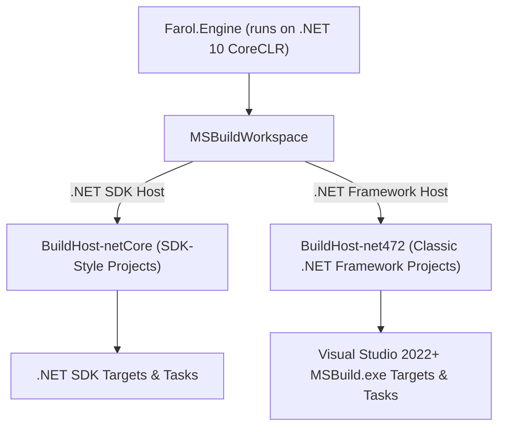
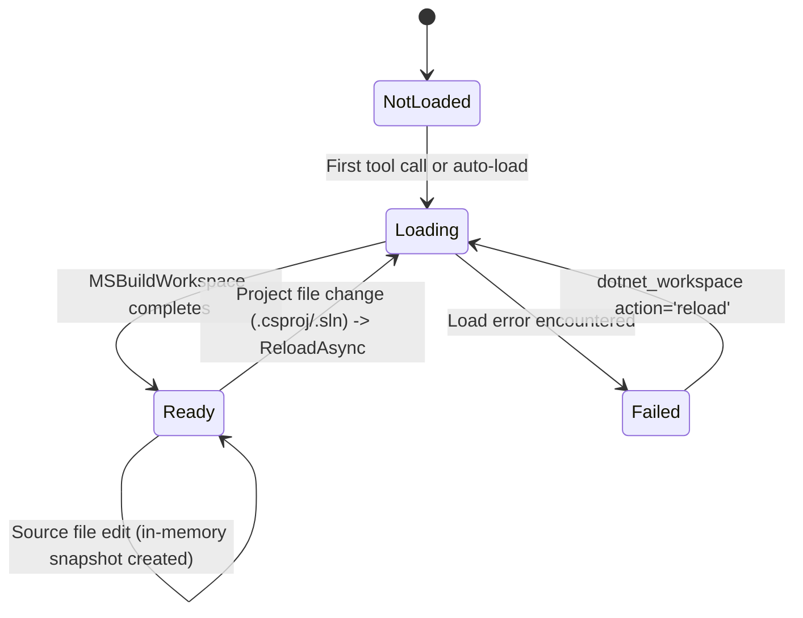

# Architecture & Design Philosophy

This document details the architectural foundation, design principles, and engineering decisions behind Farol.

---

## 1. Architectural Principles

Farol's design is guided by five foundational principles:

1. **Compiler-Grade Accuracy**: Never approximate what the compiler knows with certainty. Never rely on regex heuristics when Roslyn's semantic models can resolve exact overloads, type bindings, and syntax structures.
2. **Fast Feedback Loops**: An AI agent cannot afford a full MSBuild build after every edit. Verification should take about a second.
3. **Inclusive Legacy Fidelity**: Legacy systems (.NET Framework, VB.NET, classic `.csproj`, `packages.config`, WebForms, ASMX, WCF, WinForms, WPF) are treated as first-class citizens alongside modern .NET 10/11 codebases.
4. **Token & Context Optimization**: Output must be dense, concise, and structured specifically for LLM consumption. Redundancy, massive compiler logs, and irrelevant diagnostics must be aggressively filtered.
5. **Decoupled & Remote-Ready**: The engine is completely isolated from the transport layer. All operations work against immutable snapshots, return unified diffs, and mirror workspace identifiers into standard headers, enabling future multi-tenant HTTP gateway deployments without architectural rewrites.

---

## 2. Layered Architecture

Farol follows a strict vertical layering model with unidirectional dependencies:

```
┌────────────────────────────────────────────────────────┐
│ Farol.Host                                              │
│ - stdio JSON-RPC transport                             │
│ - CLI flags & configuration cascading                  │
│ - Standard stream isolation (stdout clean, stderr logs)│
│ - Local privacy-first telemetry logging & reports      │
└──────────────────────────┬─────────────────────────────┘
                           │ depends on
┌──────────────────────────▼─────────────────────────────┐
│ Farol.Tools                                            │
│ - 18 MCP Tools (organized across 6 feature toolsets)   │
│ - 4 MCP Prompts (workflows as slash commands)          │
│ - Parameter validation & tool guards                   │
│ - Token budgeting & truncation management              │
│ - Compact text formatting tailored for LLMs            │
└──────────────────────────┬─────────────────────────────┘
                           │ depends on
┌──────────────────────────▼─────────────────────────────┐
│ Farol.Engine                                           │
│ - Roslyn MSBuildWorkspace & dual BuildHost loader      │
│ - Immutable WorkspaceSession & WorkspaceSnapshot       │
│ - Background compilation warm-up & file watcher        │
│ - DiagnosticCheck & load baseline engine               │
│ - Cross-language Navigation (C#/VB, IOperation)        │
│ - Markup indexing (WebForms, ASMX, WCF, XAML)          │
│ - Decompilation via ICSharpCode.Decompiler             │
│ - BuildRunner & TestRunner (binlog / TRX parsers)      │
│ - Legacy inventory, config masking & migration planner │
│ - NuGet dependency analysis & public API inspector     │
└──────────────────────────┬─────────────────────────────┘
                           │ depends on
┌──────────────────────────▼─────────────────────────────┐
│ Farol.Core                                             │
│ - ZERO Roslyn / MSBuild dependencies                   │
│ - PathSandbox (symlinks, junctions, trust boundaries)   │
│ - DisplayPath (POSIX-compliant, root-relative paths)   │
│ - ProcessRunner (child process trees, stdio isolation) │
│ - AtomicFile (temp-write & atomic rename)              │
│ - UnifiedDiff (Myers diff algorithm, 3-line context)   │
│ - TokenBudget & ResponseBuilder                        │
│ - ServerPermissions (read-only mode enforcement)       │
│ - ErrorCodes & FarolException                          │
│ - Local usage logging models (IUsageLog, UsageReport)  │
└────────────────────────────────────────────────────────┘
```

### Why `Farol.Core` Has Zero Roslyn Dependencies

`Farol.Core` is intentionally isolated from Microsoft Roslyn and MSBuild packages.
- **Portability & Isolation**: Core utility functions (path sandboxing, process execution, diffing, atomic file operations, token budgeting) must execute without loading heavyweight Roslyn assemblies into memory.
- **Security Boundaries**: Path traversal checks and process lifecycle management must not depend on complex Roslyn workspace states.
- **Fast Startup & Low Footprint**: Operations that execute before a workspace is loaded (such as `--help`, `--usage-report`, and startup permission checks) run instantaneously without triggering Roslyn type initialization.

---

## 3. The Out-of-Process BuildHost Model

Loading a legacy .NET Framework solution in modern .NET is historically difficult because .NET 10 runs on CoreCLR, whereas classic `.csproj`/`.vbproj` files depend on MSBuild targets that only exist in full .NET Framework and Visual Studio installations.

Farol leverages Roslyn 5.x's out-of-process **BuildHost architecture**:



### Dual BuildHost Execution
1. **SDK-Style Projects**: Handled by the modern .NET SDK BuildHost. Evaluates multi-targeting, modern package references, analyzers, and source generators.
2. **Classic .NET Framework Projects**: Handled by `BuildHost-net472`. This host runs on the .NET Framework 4.7.2+ runtime and connects directly to Visual Studio's MSBuild (`MSBuild.exe`). It executes classic tasks, resolves assembly references from the GAC or reference assembly directories, and evaluates legacy `.csproj`/`.vbproj` files with the same MSBuild that builds them.

### Visual Studio Tools Path (`VSToolsPath`) Injection
Some legacy solutions use SDK-style project formats but target .NET Framework and import Visual Studio WebApplication targets (e.g. `$(VSToolsPath)\WebApplications\Microsoft.WebApplication.targets`). Because Roslyn directs SDK-style projects to the .NET SDK host by default, these imports would fail. Farol detects Visual Studio via `ToolchainProbe` and automatically injects the correct `VSToolsPath` into the global MSBuild properties, so these hybrid projects load.

### Analyzer Dropping for Resilient Workspace Loading
In large enterprise solutions, projects often reference custom analyzer assemblies or source generators built within the same solution. If these analyzer projects have not yet been built on disk, standard Roslyn workspaces throw fatal exceptions during symbol and reference searches. Farol intercepts unresolved analyzers (`UnresolvedAnalyzerReference`), drops them from the active workspace compilation, and issues an informative warning instructing the user to build the producer project once.

---

## 4. Immutable Snapshot Concurrency Model

Farol adopts a purely functional, immutable snapshot model for workspace state:



### Key Concurrency Characteristics
- **Non-Blocking Readers**: Every incoming tool request is bound to a single immutable `WorkspaceSnapshot` (containing a Roslyn `Solution` and an incrementing version number). Multiple tool requests execute concurrently across thread-pool threads without acquiring locks on the solution state.
- **Lazy Snapshot Refresh (`RefreshAsync`)**: When source files change on disk, the running request is not interrupted. Before the *next* request begins, pending file changes are drained and applied to generate a new immutable snapshot.
- **Rebasing on Clean State**: If an edited file is reverted to its original disk state, Farol rebases the snapshot on the original load solution, preserving existing cached compilations and avoiding redundant recompilation overhead.
- **Project File Invalidation**: Edits to source files (`.cs`, `.vb`) produce lightweight syntax/document updates. Edits to project files (`.csproj`, `.vbproj`, `.sln`, `.props`, `.targets`) make Farol reload the workspace (`ReloadAsync`), re-evaluating MSBuild properties and references; a call made meanwhile waits for it.

---

## 5. The Load Baseline Concept

Traditional tools report all compiler diagnostics present in a solution. In legacy enterprise codebases, this is catastrophic: an older codebase might have hundreds or thousands of pre-existing warnings, deprecation notices, or style violations.

Farol introduces the **Diagnostic Baseline**:

```
At Workspace Load:
  Solution Loaded ───► Load Snapshot (the baseline)

During Agent Edits:
  Current Diagnostics ───► Split(Baseline)
                             ├── Matches Baseline? ──► Silenced (Pre-existing)
                             └── New Fingerprint?  ──► Reported to Agent (Instant Feedback)
```

The load snapshot is the baseline; a project's or file's baseline diagnostics are computed on first need and cached until the next reload.

### Elimination of Line-Shift False Positives
Diagnostics are fingerprinted using four invariants:
$$\text{Fingerprint} = (\text{Diagnostic ID}, \text{Relative File Path}, \text{Error Message}, \text{Trimmed Line Text})$$

Because the line number is intentionally excluded from the fingerprint, adding or deleting lines above an existing warning shifts its physical line number without marking it as a new issue. Only if the actual code on that line is modified will it be treated as altered.

---

## 6. Remote-Ready Architecture

Although Farol operates primarily over stdio in the MVP, every layer is designed for seamless transition to remote, multi-tenant HTTP gateways (Phase 3):

- **Explicit Workspace Parameter**: Every tool accepts an optional `workspace` parameter. In HTTP requests, this parameter is mirrored into the `Mcp-Param-Workspace` header.
- **Zero Session Affinity**: No mutable state is stored in the MCP protocol session. A future gateway can route incoming requests across a pool of Farol worker instances by forwarding the target workspace path.
- **Diff-Based Modifications**: Tools like `dotnet_code_actions` return changes formatted as unified diffs. In local mode, clients can request atomic application (`apply=true`); in remote environments, diffs are returned for client-side application.
- **Root-Relative Paths**: Every file location in every response is relative to the root Farol runs in and uses forward slashes (`/`); a path outside the root, under `Farol:TrustedPaths`, is written in full. Arguments may also be relative to the workspace's folder.

---

## 7. English Compiler Enforcement

When developers work on non-English operating systems (e.g. Portuguese, Japanese, German), the .NET SDK and MSBuild localize error messages by default. This degrades LLM performance, as coding models are trained predominantly on English compiler errors (e.g. `CS0103: The name 'x' does not exist in the current context`).

Farol enforces English across all compiler interactions:
- Child processes run with `DOTNET_CLI_UI_LANGUAGE=en` and `VSLANG=1033`.
- MSBuild invocations pass `-p:PreferredUILang=en-US`.
- Roslyn diagnostics are rendered using `CultureInfo.InvariantCulture`.
- Farol ships without satellite resource assemblies (`SatelliteResourceLanguages=en`), so Roslyn's own messages stay in English.
