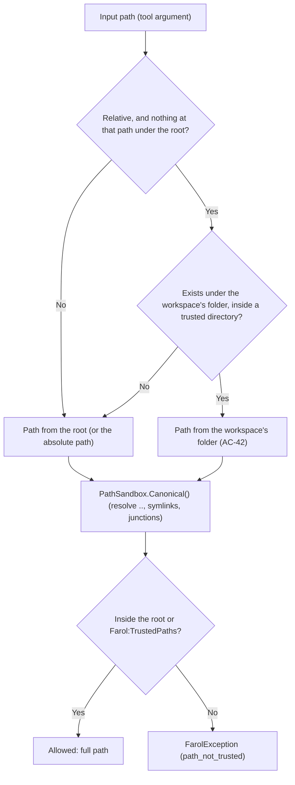

# Layer: Farol.Core

`Farol.Core` provides the foundational infrastructure for Farol. It has **strictly zero dependencies on Roslyn or MSBuild**, ensuring that path validation, process supervision, unified diff calculation, and telemetry execute with minimal memory overhead and complete isolation.

---

## 1. Component Map

```
Farol.Core
├── Paths/
│   ├── PathSandbox.cs        # Directory trust boundary & link resolution
│   ├── DisplayPath.cs        # POSIX root-relative formatting & inline redaction
│   └── ArtifactDirectory.cs  # Isolated temporary output folder management
├── Execution/
│   └── ProcessRunner.cs      # Child process execution & entire tree termination
├── Files/
│   └── AtomicFile.cs         # Temp-file write & atomic filesystem rename
├── Text/
│   ├── UnifiedDiff.cs        # Myers diff algorithm (3-line context, git apply compatible)
│   ├── TokenBudget.cs        # Token constraints & truncation tracking
│   └── ResponseBuilder.cs    # Structured, token-budgeted text output builder
├── Usage/
│   ├── IUsageLog.cs          # Local telemetry logging interface
│   ├── UsageEvent.cs         # Anonymized session, load, and tool call event models
│   ├── UsageLogFile.cs       # Daily rotating JSON Lines file store with 30-day cleanup
│   └── UsageReport.cs        # Aggregated performance & error summary generator
├── ServerPermissions.cs      # Read-only mode enforcement (--read-only)
├── CallerContext.cs          # Identity context (local process vs remote user)
├── ErrorCodes.cs             # Machine-readable error codes
└── FarolException.cs         # Structured exceptions with actionable guidance
```

---

## 2. Path Sandboxing (`PathSandbox`)

Because loading a .NET solution triggers MSBuild target evaluation and code actions write files to disk, an AI agent must never be permitted to read, execute, or overwrite files outside designated directories.

### Trust Boundary Architecture
A directory is considered trusted if it matches the server's root directory (`Farol:RootDirectory`) or is explicitly declared in `Farol:TrustedPaths`.



### Key Technical Implementations
1. **Symbolic Link & Junction Traversal (`Canonical`)**:
   Standard .NET `Path.GetFullPath` does not resolve Windows directory junctions or symbolic links. If an attacker or malicious repository contains a junction pointing to `C:\Windows` or `C:\Users\username\.ssh`, simple path prefix checks would fail.
   `PathSandbox` iteratively traverses each segment using `FileSystemInfo.ResolveLinkTarget(returnFinalTarget: true)`, protected by a recursion guard (`MaxLinkDepth = 32`).
2. **Solution-Folder Fallback Resolution (AC-42)**:
   AI agents frequently pass relative paths assuming the working directory is the solution folder (e.g. `src/MyProject/Class.cs`), even when Farol was started at a repository root above it. When a relative path names nothing under the root, `PathSandbox.Resolve` tries the workspace's folder, and uses that path only when it exists and is itself inside the trusted directories.
3. **Actionable Remediation**:
   When access is denied, Farol throws a `FarolException` with code `path_not_trusted`, saying how to trust the directory: `Farol:TrustedPaths`, or starting Farol with `--root` above it.
4. **Paths the File System Rejects (`FullPath`)**:
   A file path, a `workspace` or the path in a `path:line` symbol with a null character, or too long for the file system, is an `invalid_argument` error that quotes only the first 60 characters, since such an argument can be megabytes long or binary.

---

## 3. Process Execution & Stream Isolation (`ProcessRunner`)

Farol invokes external tools (`dotnet`, `MSBuild.exe`, `vswhere.exe`, `vstest.console.exe`) through `IProcessRunner`.

### Critical Stream Isolation
When running over stdio, **standard input and standard output carry JSON-RPC MCP messages**. If a child process were to inherit stdout, any console output from MSBuild or a compiler would corrupt the JSON stream and crash the MCP connection.

`LocalProcessRunner` enforces strict isolation:
- `RedirectStandardInput = true`, `RedirectStandardOutput = true`, `RedirectStandardError = true`.
- Standard input is immediately closed (`process.StandardInput.Close()`).
- Standard output and standard error are captured asynchronously line-by-line via events into thread-safe string buffers.

### Hardened Child Environment
Every spawned process is configured with specific environment variables:
```csharp
startInfo.Environment["MSBUILDDISABLENODEREUSE"] = "1";     // Prevents MSBuild worker processes from hanging around and locking files
startInfo.Environment["DOTNET_CLI_TELEMETRY_OPTOUT"] = "1"; // Disables .NET CLI telemetry
startInfo.Environment["DOTNET_NOLOGO"] = "1";               // Suppresses banner text
startInfo.Environment["DOTNET_CLI_UI_LANGUAGE"] = "en";     // Enforces English output from dotnet
startInfo.Environment["VSLANG"] = "1033";                   // Enforces English output from Visual Studio tools
```

### Complete Process Tree Termination
If a build or test exceeds its timeout (default: 15 minutes for builds, 20 minutes for tests) or if the agent cancels the operation, calling `process.Kill()` is insufficient on Windows because MSBuild spawns multiple child compiler nodes (`csc.exe`, `vbc.exe`).
`LocalProcessRunner` terminates the process tree completely using `process.Kill(entireProcessTree: true)`.

---

## 4. Atomic File Operations (`AtomicFile`)

When an agent applies a Roslyn code action, partial writes or in-place file overwrites introduce race conditions:
- File watchers might detect an empty or half-written file.
- A crash during writing would corrupt the user's source code.
- Compilers might read incomplete syntax trees.

`AtomicFile.WriteAllTextAsync` resolves this:
1. Writes the content to a hidden temporary file in the *same* directory: `.{filename}.{guid}.tmp`.
2. Uses the atomic OS filesystem operation `File.Move(temporary, path, overwrite: true)`.
3. If an exception occurs, the temporary file is deleted in a `catch` block.

---

## 5. Myers Unified Diffing (`UnifiedDiff`)

Farol formats code modifications using the standard unified diff format (3 lines of context), making changes instantly readable by LLMs and fully compatible with `git apply`.

- **Myers Algorithm**: Implements Myers' $O(ND)$ difference algorithm with common prefix and suffix pruning.
- **Large-File Safety Guard**: If the edit distance exceeds `MaxEditDistance = 2000`, Farol avoids expensive quadratic path searches and falls back to hunk-based chunk replacement.
- **Line Ending & EOF Normalization**: Reads `\r\n`, `\n` and `\r` line endings; the diff itself is written with `\n`. It appends `\ No newline at end of file` when appropriate.

---

## 6. Display Path Formatting (`DisplayPath`)

LLMs perform best when file paths are short, clean, and consistent.

- **Root-Relative Normalization**: Paths are written relative to the root Farol runs in, with forward slashes (`/`) even on Windows (`src/Core/Order.cs:42`); a path outside the root, under `Farol:TrustedPaths`, is written in full.
- **Folded Location Summaries (`Places`)**: When listing multiple occurrences of a symbol across files, Farol folds repeated files into concise lines:
  ```
  Folder/File.cs:14, :26, Other.cs:3, … 4 more
  ```
- **In-Text Sanitization (`InText`)**: When MSBuild or Roslyn outputs compiler messages containing raw Windows absolute paths (e.g. `C:\Users\bs\source\repos\Farol\src\A.cs(12,5): error CS0103`), Farol sanitizes the message in-place, rewriting paths to root-relative form.

---

## 7. Token Budgeting (`TokenBudget` & `ResponseBuilder`)

Context windows are a finite, expensive resource. Farol enforces token budgets on all list-producing tools:
- Default budget: **1,500 tokens** (configurable up to **8,000 tokens** via `maxTokens`).
- Estimator: Fast character-to-token ratio approximation ($1\text{ token} \approx 4\text{ chars}$).
- Truncation marker: When a list exceeds the budget, the output terminates cleanly with `… N more` and instructions on how to page via `offset`.

---

## 8. Server Permissions (`ServerPermissions`)

When Farol starts with `--read-only`, the server blocks any operation that produces side effects:
- `dotnet_code_actions` with `apply=true` is refused (preview diffs still work).
- `dotnet_migration_plan` with `write=true` is refused (plan viewing still works).
- `dotnet_build` and `dotnet_test` are refused.

When refused, the tool throws a `FarolException` (`read_only`) explaining that `--read-only` is active and detailing alternative non-destructive actions.

---

## 9. Privacy-First Local Telemetry (`Usage`)

Farol contains **zero network telemetry**; no data is ever sent to external servers. To help developers and teams track usage, performance, and reliability, Farol includes an opt-in local usage logger (`--usage-log`).

- **Storage Location**: Stored as daily rotating JSON Lines files under `%LOCALAPPDATA%\Farol\usage\`.
- **Complete Anonymization**:
  - Solution paths are never recorded; solutions are identified solely by an 8-character SHA-256 hash of their filename.
  - No source code, symbols, method names, file paths, or arguments are logged.
  - Records event kind (`start`, `session`, `load`, `warm`, `call`, `crash`), elapsed time, outcome, error code, and token budget truncation flags.
- **Automatic Retention**: Files older than 30 days are deleted when Farol opens the log.
- **Built-in Reporting**: Running `farol --usage-report [--days N]` parses the local logs and prints a plain-text summary: days with use, sessions and clients, each tool's calls, errors and p50/p95 durations, errors by code and loads per solution.
