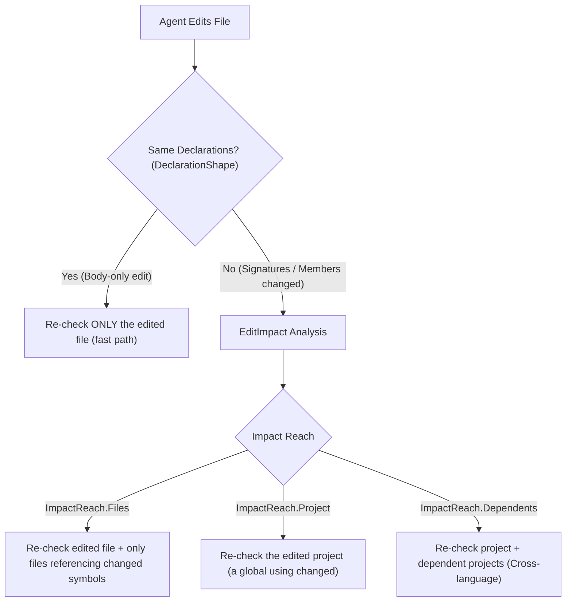

# Layer: Farol.Engine — Verification & Testing

The Verification and Testing subsystem delivers fast, compiler-accurate feedback for agent edits, provides Roslyn lightbulb quick-fixes and refactorings, executes toolchain-appropriate builds, and runs impacted tests.

---

## 1. Subsystem Architecture

```
Farol.Engine (Verification & Testing)
├── Diagnostics/
│   ├── DiagnosticCheck.cs        # Compiler check engine (about a second)
│   ├── DiagnosticBaseline.cs     # Baseline diagnostics of the load, computed on first need
│   ├── DeclarationShape.cs       # Syntax-only declaration diffing (body vs signature changes)
│   ├── EditImpact.cs             # Dependency reach analysis for modified symbols
│   ├── CheckCompilations.cs      # Reusable compilations with replaced reference pointers
│   └── CheckModels.cs            # Requests, plans, and results models
├── CodeActions/
│   ├── CodeActionFinder.cs       # Discovers Roslyn fixes & refactorings at line/column
│   ├── CodeActionEditor.cs       # Generates unified diff previews & applies edits atomically
│   └── CodeActionProviders.cs    # Reflection-based provider loader for C# and VB.NET
├── Building/
│   ├── BuildRunner.cs            # Orchestrates dotnet build and Visual Studio MSBuild.exe
│   ├── BuildLogReader.cs         # Parses binary logs (.binlog) via MSBuild.StructuredLogger
│   └── BuildModels.cs            # Build commands, results, and issues
└── Testing/
    ├── TestRunner.cs             # Runs tests via vstest.console or dotnet test, reads TRX
    ├── AffectedTestFinder.cs     # Backward call-graph traversal to find impacted tests
    ├── ChangedMembers.cs         # Identifies symbols altered between two snapshots
    ├── TestCommands.cs           # Selects test host (vstest, dotnet test, Microsoft.Testing.Platform)
    ├── TestFrameworks.cs         # Identifies test attributes (xUnit, NUnit, MSTest, TUnit)
    ├── TestProjects.cs           # Discovers test projects and their dependencies
    └── TestResults.cs            # Parses TRX XML files, extracts failures and user stack frames
```

---

## 2. Diagnostic Checking in About a Second (`DiagnosticCheck`)

When an agent edits code, a full build takes far longer than a check. Farol's `dotnet_check` returns compiler feedback in **about a second (p95 under 2 s)**.

### Why Compiler Diagnostics Only?
Full analyzer suites (such as `Microsoft.CodeAnalysis.NetAnalyzers`, style rules, and third-party Roslyn analyzers) execute hundreds of complex AST rules. `dotnet_check` evaluates **compiler diagnostics only** (syntax, semantic type binding, overload resolution, and declaration errors). Full analyzer warnings are deferred to `dotnet_build`.

### Baseline Fingerprinting (`DiagnosticBaseline`)
Legacy projects frequently have hundreds of pre-existing warnings. The load snapshot is the baseline; a project's or file's baseline diagnostics are computed on first need and cached until the next reload. When an edit is checked, Farol matches current diagnostics against the baseline using a 4-part fingerprint:
$$\text{Fingerprint} = (\text{Diagnostic ID}, \text{File Path}, \text{Message}, \text{Line Text})$$
- Pre-existing issues are suppressed.
- Only newly introduced issues are returned to the agent.
- Because line numbers are excluded from the fingerprint, edits that add or remove lines above an existing warning do not falsely mark it as new.

---

## 3. Incremental Re-Checking: `DeclarationShape` & `EditImpact`

In large solutions (e.g. DNN Platform: 80 projects, 0.58M lines), recompiling every project that depends on an edited file would be far too slow. Farol uses a two-stage reach analysis:



1. **Syntax-Only Declaration Comparison (`DeclarationShape`)**:
   Compares the AST declaration shapes before and after the edit. If method bodies or property getters/setters changed but class headers, method signatures, return types, and field declarations remained identical, Farol re-checks **only the edited file**.
2. **Selective Reach Analysis (`EditImpact`)**:
   If declarations changed, Farol identifies the reach:
   - If a member was modified or deleted, Farol finds only the specific files across the solution that reference that member and re-checks them.
   - If an abstract member was added, Farol identifies derived classes needing implementation.
   - If a member was added, the files that name it are re-checked too (overloads, hiding, ambiguity). Changes a name cannot bound (type headers, operators, assembly attributes) re-check the dependent projects whole.
   - Cross-language propagation works automatically: changing a C# method signature will surface the compilation error inside the calling VB.NET project.
3. **Optimized Compilation Reuse (`CheckCompilations`)**:
   Projects that have no edits of their own are not rebuilt. Instead, Farol re-uses their load-time compilations and updates only the assembly reference pointer to the edited project (`Compilation.ReplaceReference`). This avoids recompiling the projects the edit cannot affect.

---

## 4. Visual Studio Lightbulb Code Actions (`CodeActions`)

`dotnet_code_actions` surfaces Roslyn's native IDE quick-fixes and refactorings directly to the AI agent.

### Capabilities
- **Compiler Fixes (`fix`)**: Adds missing `using`/`Imports` statements, generates missing methods/properties, implements interfaces, fixes type mismatches.
- **Refactorings (`refactoring`)**: Extracts methods, introduces local variables, converts foreach to LINQ, etc.
- **Preview Mode**: Returns a unified diff showing exact changes across affected files without altering disk state.
- **Apply Mode (`apply=true`)**:
  - Verifies that the file on disk has not drifted since the snapshot was taken.
  - Applies edits atomically using `AtomicFile`.
  - Automatically runs an immediate `dotnet_check` and returns the fresh compiler verification in the same response.
  - Blocked under `--read-only` mode.

---

## 5. Toolchain-Aware Build Runner (`BuildRunner`)

`dotnet_build` compiles the solution or a specified project using the exact toolchain required for that code:

| Project Type | Toolchain Selected | Arguments & Options |
|---|---|---|
| **Modern SDK-Style Projects** | `dotnet build` | `-c Configuration -nologo -v:m -clp:NoSummary -bl:... -p:PreferredUILang=en-US` |
| **Classic .NET Framework Projects** | Visual Studio `MSBuild.exe` | `-restore -p:Configuration=… -m -nodeReuse:false -nologo -v:m -clp:NoSummary -bl:… -p:PreferredUILang=en-US` (plus `-p:RestorePackagesConfig=true` with packages.config) |

### Binary Log Extraction (`MSBuild.StructuredLogger`)
Farol configures every build to write an MSBuild binary log (`.binlog`) to a temporary artifacts directory. Farol reads the `.binlog` directly using `MSBuild.StructuredLogger`:
- Extracts exact errors and warnings directly from the structured object model.
- Eliminates parsing errors caused by localized console text.
- **Deduplication across Target Frameworks**: In multi-targeting projects (`net10.0;net48`), an error is emitted once per framework. Farol deduplicates identical errors, displaying them as a single issue with a list of affected frameworks.

### Concurrency Protection
Running concurrent MSBuild processes against the same solution results in file locking errors inside intermediate output directories (`obj/`). `BuildRunner` enforces a per-workspace concurrency lock (`AcquireAsync`), serializing builds and test runs. This also holds across Farol processes, through a `turn.lock` file in Farol's build folder; the second process waits and says so in its progress every 15 seconds. After the build and test timeouts together, it stops waiting with a `conflict` error.

---

## 6. Test Runner & Affected Test Detection (`TestRunner`)

`dotnet_test` runs tests and reports failures concisely.

### Test Host Selection
- **Classic .NET Framework Test Projects**: Executed via Visual Studio's `vstest.console.exe`.
- **Modern SDK-Style Projects**: Executed via `dotnet test`, on VSTest or on `Microsoft.Testing.Platform` when the nearest `global.json` sets `"test": { "runner": "Microsoft.Testing.Platform" }`.

### Failure-Focused Output
Passing tests waste context tokens. Farol parses the output TRX files and returns **failures only**:
- The exact failing test name.
- The assertion message.
- **Filtered Stack Trace**: Automatically filters out framework and test runner frames (xUnit, NUnit, MSTest internals), surfacing only the stack frames located in user code.

### Affected Test Detection (`AffectedTestFinder`)
When an agent passes `affectedBy='changes'` or `affectedBy='SymbolName'`:
1. Identifies the modified symbols.
2. Traces references **backwards through the call graph**: from each symbol's callers, through enclosing members, interface implementations, and overrides.
3. Stops when it reaches test methods (recognized via `TestFrameworks`).
4. Executes **only the impacted tests**, allowing agents to verify behavioral changes in seconds rather than running the full test suite.
