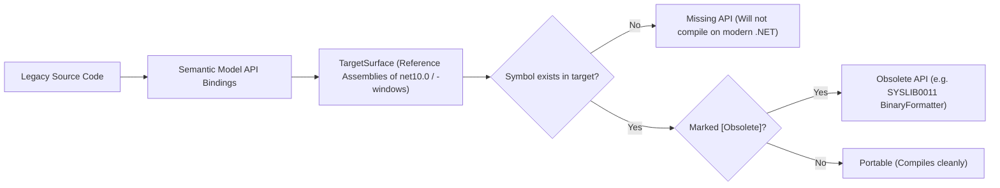

# Layer: Farol.Engine — Legacy Modernization & Packages

The Legacy Modernization and Packages subsystem provides automated tooling for assessing legacy .NET Framework applications, inspecting configurations safely, planning migrations to modern .NET, and evaluating NuGet package dependencies without hallucinations.

---

## 1. Subsystem Architecture

```
Farol.Engine (Legacy & Packages)
├── Legacy/
│   ├── LegacyInventory.cs        # Comprehensive inventory of legacy technologies & hotspots
│   ├── ApiUsageScanner.cs        # Scans semantic models for referenced legacy framework APIs
│   ├── ConfigInspector.cs        # Web.config / app.config parser with secret masking
│   ├── PortabilityAnalyzer.cs    # Evaluates API compatibility against target reference assemblies
│   ├── TargetSurface.cs          # Loads targeting pack reference assemblies (net10.0, -windows)
│   ├── LegacyCatalog.cs          # Knowledge base of legacy technologies and modern replacements
│   ├── MigrationPlanner.cs       # Bottom-up topological migration plan generator
│   └── MigrationDocuments.cs     # Markdown generator (assessment.md, plan.md, tasks.md)
└── Packages/
    ├── PackageInventory.cs       # Direct & transitive package dependency analyzer
    ├── PackageApi.cs             # Extracts public API signatures & XML docs from package binaries
    ├── PackageFeeds.cs           # NuGet feed client (advisories, deprecations, newer versions)
    ├── PackageModels.cs          # Package manifests, advisories, and API models
    └── NuGetContext.cs           # Discovers nuget.config, credential providers, and local caches
```

---

## 2. Legacy Inventory (`LegacyInventory`)

`dotnet_legacy_inventory` provides a comprehensive census of legacy technologies across the solution:

- **Project Formats**: Classic `.csproj`/`.vbproj` vs. SDK-style projects.
- **Target Frameworks**: Projects targeting .NET Framework (e.g. `v4.0`–`v4.8.1`).
- **Package Management**: Projects using legacy `packages.config` instead of `PackageReference`.
- **Legacy Application Models**:
  - ASP.NET WebForms pages, user controls, and master pages (`.aspx`, `.ascx`, `.master`, `Global.asax`).
  - ASMX Web Services (`.asmx`) and WCF Services (`.svc`).
  - WinForms forms and user controls (detected via class inheritance).
  - WPF XAML views and resources.
- **Problematic Legacy APIs (`ApiUsageScanner`)**:
  - `BinaryFormatter` (insecure serialization).
  - `System.Configuration.ConfigurationManager`.
  - `System.Web` APIs (HttpContext, WebConfigurationManager).
  - `System.Runtime.Remoting`.
- **Legacy Hotspots**: Identifies the specific source files with the highest concentration of legacy lines.

---

## 3. Safe Configuration Inspection (`ConfigInspector`)

In .NET Framework systems, `web.config` and `app.config` files commonly hold sensitive production credentials alongside architectural settings.

### Zero Secret Leakage
`ConfigInspector` strictly masks credentials before returning configuration data to the agent:
- Passwords, keys and tokens inside connection strings are replaced with `***`, keeping the rest readable.
- App settings whose names look like credentials (password, secret, token, API or access key, credential, signature, connection string) are masked.
- Machine keys (`<machineKey>`) are masked.

### Modern JSON Mapping
`ConfigInspector` automatically computes the equivalent modern `appsettings.json` representation:
- Converts flat XML `<appSettings>` into nested JSON structures by splitting hierarchical keys (e.g. `Smtp:Server` maps to `{ "Smtp": { "Server": "..." } }`).
- Translates `<connectionStrings>` into standard modern ASP.NET Core `ConnectionStrings` configuration objects.

---

## 4. Target Surface Portability (`PortabilityAnalyzer`)

Unlike naive regex-based migration tools, `PortabilityAnalyzer` checks code against **actual reference assemblies** of the target framework:



1. **Target Surface Loading (`TargetSurface`)**:
   Loads the official .NET reference assemblies for the chosen target (default: `net10.0`). Projects using WinForms or WPF are evaluated against the `net10.0-windows` targeting pack.
2. **Missing vs. Obsolete Classification**:
   - **Missing**: The type or member does not exist in modern .NET (e.g. `System.Web.UI.Page`).
   - **Obsolete**: The type exists but emits modern deprecation warnings (e.g. `SYSLIB0011` for `BinaryFormatter`).
3. **Actionable Replacements (`LegacyCatalog`)**:
   Maps each identified issue to its official replacement (e.g. `BinaryFormatter` $\rightarrow$ `System.Text.Json`, `ConfigurationManager` $\rightarrow$ `Microsoft.Extensions.Configuration`).

---

## 5. Automated Migration Planning (`MigrationPlanner`)

`dotnet_migration_plan` synthesizes inventory and portability data into an actionable, step-by-step modernization strategy.

### Bottom-Up Topological Sequencing
Projects are ordered by their dependency hierarchy:
1. **Shared Class Libraries**: Multi-target modern .NET (`net10.0`) and legacy .NET Framework (`net48`).
2. **Unit Test Projects**: Modernize to execute against both frameworks.
3. **Desktop Applications (WinForms / WPF)**: Retarget directly to `net10.0-windows`.
4. **Web Applications (WebForms / WCF / MVC 5)**: Structured incremental migration using ASP.NET Core, YARP (Yet Another Reverse Proxy), and System.Web adapters.

### Document Generation (`write=true`)
When `write=true` is specified, Farol saves structured documents under `docs/modernization/`:
- `assessment.md`: High-level summary of solutions, target frameworks, and legacy inventory.
- `plan.md`: Step-by-step architectural migration sequence.
- `tasks.md`: Detailed markdown checklists referencing exact `file:line` locations.
- **Checkbox State Preservation**: If an agent or human marks a task as completed (`- [x]`), regenerating the migration plan preserves the checked state.

---

## 6. NuGet Package Dependency Analysis (`PackageInventory`)

`dotnet_packages` maps the package ecosystem across projects:
- **Direct vs. Transitive Packages**: Distinguishes direct references from transitive dependencies, displaying the exact chain that pulled each transitive package in.
- **Format Support**: Evaluates both modern SDK-style PackageReferences (including Central Package Management via `Directory.Packages.props`) and classic `packages.config`.
- **Security & Deprecation Advisories**: Asks the workspace's NuGet feeds, through the NuGet client (credential providers, HTTP cache, package source mapping), about known vulnerabilities, deprecation (with the recommended replacement) and newer versions.
- **Offline Mode (`--offline`)**: When offline, queries the cached vulnerability data recorded during the last restore inside `project.assets.json`.

---

## 7. Exact Package API Extraction (`PackageApi`)

To prevent LLM hallucinations when upgrading or consuming packages, `dotnet_package_api` extracts the verified public API surface:

1. **Local-First Assembly Discovery**:
   Inspects the local NuGet cache (`%USERPROFILE%\.nuget\packages`), fallback directories, or the solution's `packages` directory. If missing and not `--offline`, downloads the package into the global packages folder, the way restore does.
2. **Roslyn Compilation against Runtime Metadata**:
   Loads the package's assembly for the requested target framework into an in-memory Roslyn compilation backed by runtime framework assemblies.
3. **Exact Signatures and XML Documentation**:
   Outputs exact type definitions, method signatures, parameter types, and XML documentation summaries from the package's `.xml` file, giving the agent a definitive source of truth without guessing.
