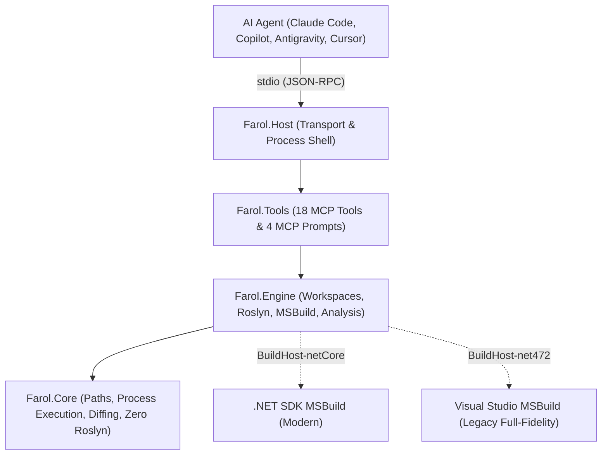

# Farol: A Lighthouse for AI Agents in .NET Codebases

> *From .NET Framework to .NET 11.*

**Farol** (Portuguese for *Lighthouse*) is an open-source [Model Context Protocol (MCP)](https://modelcontextprotocol.io) server that provides AI coding agents (Claude Code, GitHub Copilot, Google Antigravity, Cursor, Codex) with **compiler-accurate understanding of C# and VB.NET solutions**.

Unlike traditional tools that only work on modern SDK-style projects or rely on rudimentary text pattern searches, Farol provides first-class support for the entire .NET spectrum, including the legacy codebases that other tools abandon: classic `.csproj`/`.vbproj`, `packages.config`, ASP.NET WebForms, WCF, ASMX, WinForms, and WPF.

---

## The Problem: Why grep + build Fails AI Agents

When an AI agent works on a complex .NET repository using standard file tools (`grep`, `find`, `cat`, and `dotnet build`), it encounters severe friction:

1. **Text Search is Blind to Compiler Semantics**:
   - `grep` cannot differentiate between a symbol declaration, an invocation, an assignment, a type constraint, or an occurrence inside a comment or string literal.
   - It cannot resolve overloads, track inherited methods, identify interface implementations, or navigate cross-language references (e.g., C# calling VB.NET).
   - In ASP.NET WebForms or WPF, markup files (`.aspx`, `.ascx`, `.master`, `.xaml`) reference event handlers and code-behind classes implicitly. Text searches frequently miss these connections, leading agents to falsely assume code is unused and delete it.
2. **Build Feedback Loops are Prohibitively Expensive**:
   - Running `dotnet build` on a medium-to-large solution takes between 30 seconds and several minutes.
   - A single build dumps hundreds of lines of noise, warnings, and duplicated messages into the agent's context window, spending many tokens.
   - In multi-targeted projects, every warning and error is repeated for each target framework.
3. **Package Hallucinations**:
   - LLMs frequently hallucinate APIs of external NuGet packages, guessing method signatures or assuming APIs from newer versions exist in older pinned dependencies.
4. **The Legacy Abyss**:
   - Roslyn-based MCP servers such as `roslyn-codelens` skip non-SDK projects.
   - Non-SDK projects, `packages.config`, and legacy enterprise frameworks (WebForms, ASMX, WCF) represent millions of lines of active enterprise code, yet agents have had zero semantic tooling to maintain or modernize them.

---

## The Solution: Compiler-Accurate Intelligence

Farol addresses these challenges by embedding the Microsoft Roslyn compiler and MSBuild engine directly into an MCP server with a clean, decoupled 4-layer architecture:

- **Instant Compiler Feedback (`dotnet_check`)**: In about a second (p95 under 2 s), Farol evaluates syntactic and semantic changes made by the agent. It computes a **load baseline** and returns **only newly introduced compiler errors and warnings**, completely suppressing pre-existing legacy issues and line-shift false positives.
- **Full-Fidelity Legacy Support**: Through an out-of-process `BuildHost-net472` integrating with Visual Studio 2022+ / Build Tools MSBuild, Farol evaluates classic project files, `packages.config`, WebForms, ASMX, WCF, and VB.NET.
- **Markup-Aware Reference Tracking**: Farol indexes `.aspx`, `.ascx`, `.master`, `.svc`, `.asmx`, `.asax`, and `.xaml` files, connecting code-behind classes, event handlers, and service hosts directly to compiler symbols.
- **Decompilation and Public Package API Inspection**: Agents can inspect the verified public API surface and XML documentation of any NuGet package version without hallucinating. The package's assemblies are read with Roslyn; `dotnet_symbol` decompiles external code with ICSharpCode.Decompiler.
- **Automated Modernization Strategy**: Generates a dependency-ordered, bottom-up modernization plan with exact API portability diagnostics against modern targets (`net10.0`, `net10.0-windows`), exporting structured reports directly to markdown.

---

## The Three Jobs Farol Serves

Farol was architected with equal priority across three core enterprise jobs:

| Job | Description | Key Capabilities |
|---|---|---|
| **1. Maintain & Evolve Legacy .NET** | Day-to-day bug fixes, refactoring, and feature additions in existing .NET Framework systems in production. | Full MSBuildWorkspace fidelity on Windows, WebForms/XAML reference finding, `vstest.console` test execution, safe `web.config` inspection with secrets masked. |
| **2. Modernize Legacy Code** | Migrating legacy .NET Framework applications to modern .NET 10/11. | `dotnet_legacy_inventory`, `dotnet_portability` target analysis, `dotnet_migration_plan` generation, `packages.config` migration mapping. |
| **3. Day-to-Day Modern .NET Development** | Rapid feature development on modern .NET solutions. | SDK-style projects, Central Package Management (CPM), Microsoft.Testing.Platform support, Roslyn lightbulb code actions, edit checks in about a second. |

---

## Architectural Overview

Farol is structured into four distinct, strictly decoupled layers:



1. **`Farol.Host`**: The executable entry point. Manages stdio JSON-RPC transport, strictly ensures stdout is reserved for MCP protocol messages, pipes diagnostics to stderr, handles CLI arguments, and manages local privacy-first usage logging.
2. **`Farol.Tools`**: The MCP interface layer. Implements the 18 tool contracts and 4 prompts, manages input validation, enforces token budgets, and formats responses into dense, LLM-optimized compact text.
3. **`Farol.Engine`**: The core domain engine. Manages Roslyn `MSBuildWorkspace` sessions, immutable snapshots, background compilation warmup, diagnostic checks in about a second, markup parsing, package resolution, and legacy modernization analysis.
4. **`Farol.Core`**: The low-level infrastructure library. Has **zero dependencies on Roslyn or MSBuild**. Manages path sandboxing, boundary security, process execution with tree cleanup, Myers unified diffs, atomic file I/O, and token budgeting.

---

## Quickstart & Installation

### Option 1: Claude Code Plugin (Recommended)

Install the Farol plugin directly in Claude Code. This automatically sets up the MCP server, a `PostToolUse` hook that verifies every `.cs`/`.vb` edit with `dotnet_check`, and a dedicated modernization skill:

```bash
/plugin marketplace add yuriafp/Farol
/plugin install farol@farol
```

### Option 2: Run via `dnx` (Any MCP Client)

Farol is published on NuGet as [`Farol.Mcp`](https://www.nuget.org/packages/Farol.Mcp). Using the .NET 10 SDK, clients can launch Farol without prior installation using `dnx`:

In `.mcp.json`:
```json
{
  "mcpServers": {
    "farol": {
      "command": "dotnet",
      "args": ["dnx", "Farol.Mcp@0.1.0-alpha.4", "--yes"]
    }
  }
}
```

### Option 3: Global .NET Tool

To install Farol once globally:

```bash
dotnet tool install --global Farol.Mcp --prerelease
```

Client configuration:
```json
{
  "mcpServers": {
    "farol": {
      "command": "farol",
      "args": []
    }
  }
}
```

---

## Wiki Table of Contents

Navigate through the in-depth, layer-by-layer technical documentation:

1. [Architecture & Design Philosophy](01-Architecture-and-Design-Philosophy) — High-level architecture, snapshot immutability, BuildHost isolation, and remote-readiness.
2. [Layer: Farol.Core](02-Layer-Farol.Core) — Path sandboxing, process execution, diff generation, atomic writes, and privacy-first local logging.
3. [Layer: Farol.Engine — Workspaces & Loading](03-Layer-Farol.Engine-Workspaces-and-Loading) — Workspace lifecycles, dual BuildHost loading, toolchain discovery, and background warmup.
4. [Layer: Farol.Engine — Navigation & Markup](04-Layer-Farol.Engine-Navigation-and-Markup) — Compiler-accurate symbol search, IOperation classification, WebForms & XAML indexers, and assembly decompilation.
5. [Layer: Farol.Engine — Verification & Testing](05-Layer-Farol.Engine-Verification-and-Testing) — Diagnostic checks in about a second, baseline fingerprinting, Roslyn lightbulb actions, build runner, and affected test analysis.
6. [Layer: Farol.Engine — Legacy Modernization & Packages](06-Layer-Farol.Engine-Legacy-and-Packages) — Legacy inventory, config secret masking, target surface portability, migration planning, and NuGet inspection.
7. [Layer: Farol.Tools & MCP Contract](07-Tools-Layer-and-MCP-Contract) — Detailed specifications, parameters, and examples for all 18 tools and 4 prompts.
8. [Layer: Farol.Host & CLI](08-Host-Layer-and-CLI) — Process lifecycle, stdio communication, configuration precedence, and telemetry reporting.
9. [Integrations & Plugins](09-Integrations-and-Plugins) — Claude Code, Visual Studio 2026, Copilot, Antigravity, VS Code, and NuGet packaging.
10. [Benchmarks & Evals](10-Benchmarks-and-Evals) — Performance targets (Umbraco CMS & DNN Platform), empirical eval results (Claude Haiku 4.5, harder task set: +31 points of success, 32% fewer tokens), and the compiler oracle methodology.
